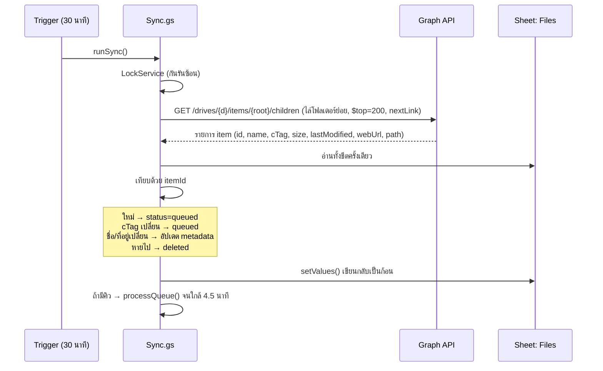

# SearchDocSystem — System Design

ระบบค้นหาเอกสารจากโฟลเดอร์ OneDrive ขององค์กร (Daihen Electric) โดยใช้ **Google Apps Script (GAS)** เป็นตัวกลางระหว่าง OneDrive กับหน้าเว็บค้นหา

| หัวข้อ | สรุป |
|---|---|
| แหล่งข้อมูล | โฟลเดอร์ OneDrive ของ `supansa@daihen.co.th` (ลิงก์แชร์แบบมีรหัสผ่าน) |
| ตัวกลาง | Google Apps Script — sync, แตกข้อความ, สร้าง index, ให้บริการหน้าเว็บ |
| ฐานข้อมูล | Google Sheets (metadata) + Google Drive (ข้อความที่แตกได้ + ไฟล์ index) |
| ค้นหาได้จาก | ชื่อไฟล์, path โฟลเดอร์, เนื้อหาภายในไฟล์ (PDF รวมถึงแบบสแกน, Word, Excel, PowerPoint) ภาษาไทย/อังกฤษ |
| หน้าเว็บ | GAS HtmlService ตาม design system ใน [DESIGN.md](DESIGN.md) — ดูต้นแบบที่ [`prototype/index.html`](../prototype/index.html) |
| ค่าใช้จ่าย | ฟรี (Gmail + Apps Script quota ฟรี; การลงทะเบียน App ใน Entra ID ไม่มีค่าใช้จ่าย) |

---

## 1. ประเด็นสำคัญ: ลิงก์แชร์แบบมีรหัสผ่าน

ลิงก์ที่ได้มา (`https://daihenelectric-my.sharepoint.com/:f:/g/personal/supansa_daihen_co_th/...`) เป็นลิงก์ **"Anyone with the link" + รหัสผ่าน** ซึ่งออกแบบมาให้ **คนเปิดใน browser แล้วพิมพ์รหัสผ่าน** ในหน้าเว็บของ SharePoint

| วิธี | ใช้ได้ไหม | เหตุผล |
|---|---|---|
| ส่งรหัสผ่านผ่าน Microsoft Graph API | ❌ | API `/shares/{shareId}/driveItem` ของ Graph **ไม่มีพารามิเตอร์สำหรับรหัสผ่าน** ลิงก์ที่มีรหัสผ่านจึงเปิดผ่าน API แบบไม่ยืนยันตัวตนไม่ได้ |
| จำลองการกรอกฟอร์มรหัสผ่าน (scrape หน้า SharePoint ด้วย `UrlFetchApp`) | ⚠️ ไม่แนะนำ | หน้าเว็บ SharePoint ใช้ JavaScript, cookie และ token หลายชั้น เปลี่ยนได้โดยไม่แจ้ง อ่านรายการโฟลเดอร์ได้ไม่แน่นอน และขัดต่อการใช้งานที่ Microsoft รองรับ |
| **Graph API + App ที่ลงทะเบียนใน Entra ID** | ✅ **แนะนำ** | App ยืนยันตัวตนเป็น "แอปขององค์กร" — **ไม่ต้องใช้รหัสผ่านของลิงก์เลย** ใช้ลิงก์หรือ path แค่เพื่อระบุว่าโฟลเดอร์ไหน |

> **สรุป:** ระบบจะ **ไม่เก็บและไม่ใช้รหัสผ่านของลิงก์** รหัสผ่านนั้นยังคงใช้สำหรับคนที่เปิดลิงก์ด้วยมือตามปกติ
>
> ⚠️ รหัสผ่านถูกส่งในแชทแล้ว ควรให้เจ้าของโฟลเดอร์ **เปลี่ยนรหัสผ่านของลิงก์** (OneDrive → Manage access → ลิงก์ → ตั้งรหัสผ่านใหม่) และห้ามใส่รหัสผ่านลงในโค้ดหรือ repo

### 1.1 ทางเลือกการเข้าถึง (เลือกตามสิทธิ์ที่ได้จาก IT)

| ระดับ | วิธี | ต้องการจาก IT | ข้อดี / ข้อเสีย |
|---|---|---|---|
| **A (แนะนำ)** | Graph **Application permission** (client credentials) — `Sites.Selected` หรือ `Files.Read.All` | IT Admin ลงทะเบียน App + **Grant admin consent** | ทำงานอัตโนมัติ 100% ไม่ผูกกับบัญชีคน · `Sites.Selected` จำกัดให้อ่านได้เฉพาะ OneDrive ของ supansa (ปลอดภัยที่สุด) |
| **B** | Graph **Delegated permission** — login บัญชี Microsoft ที่เข้าถึงโฟลเดอร์ได้ (เช่น supansa หรือบัญชีกลาง) **ครั้งเดียว** ด้วยไลบรารี [apps-script-oauth2](https://github.com/googleworkspace/apps-script-oauth2) แล้วเก็บ refresh token | ลงทะเบียน App ได้เองถ้า tenant อนุญาต user consent สำหรับ `Files.Read.All` + `offline_access` | ไม่ต้องรอ admin consent · ถ้าบัญชีนั้นเปลี่ยนรหัสผ่าน/ลาออก ต้อง login ใหม่ |
| **C (สำรอง)** | เจ้าของโฟลเดอร์ **แชร์โฟลเดอร์ให้บัญชีกลาง** (`People you choose`) แล้วใช้วิธี B กับบัญชีกลางนั้น | ไม่ต้องใช้ admin | ไม่ผูกกับบัญชีส่วนตัว |

ทั้ง 3 แบบใช้โค้ดชุดเดียวกัน ต่างกันแค่ฟังก์ชันขอ token (`Auth.gs`)

### 1.2 ระบุโฟลเดอร์ต้นทาง
Admin ใส่ได้ 2 รูปแบบ ระบบแปลงเป็น `driveId` + `itemId` แล้วเก็บไว้:

```
1) ลิงก์แชร์:   https://daihenelectric-my.sharepoint.com/:f:/g/personal/supansa_daihen_co_th/IgBQ...
               → GET /shares/u!{base64url(link)}/driveItem   (ใช้ token ของ App / ผู้ใช้ในองค์กร)
2) owner:path:  supansa@daihen.co.th:/Documents/<ชื่อโฟลเดอร์>
               → GET /users/{upn}/drive/root:/{path}
```
> ลิงก์แบบมีรหัสผ่านอาจ resolve ผ่าน `/shares` ไม่ได้แม้ใช้ token ขององค์กร **ต้องทดสอบใน Phase 0** — ถ้าไม่ได้ ใช้รูปแบบที่ 2 (ทราบได้จาก URL: owner = `supansa_daihen_co_th` → `supansa@daihen.co.th`)

---

## 2. สถาปัตยกรรม

```mermaid
flowchart LR
    U[ผู้ใช้<br/>Browser / มือถือ] -->|เปิดเว็บ| WEB[GAS Web App<br/>HtmlService]
    WEB <-->|google.script.run| API[GAS Api.gs]
    T[Time trigger<br/>ทุก 30 นาที] --> SYNC[GAS Sync.gs]
    SYNC -->|UrlFetchApp + Bearer token| G[Microsoft Graph]
    G --> OD[(OneDrive<br/>supansa@daihen.co.th)]
    SYNC --> Q[(Sheet: Files<br/>+ คิวงาน)]
    Q --> EXT[GAS Extract.gs<br/>แตกข้อความ]
    EXT -->|PDF → OCR ไทย<br/>Office → แปลงไฟล์| DRV[Drive API<br/>Advanced Service]
    EXT --> TXT[(Drive: /text/*.txt)]
    EXT --> IDX[GAS Index.gs]
    IDX --> SI[(Drive: search-index.json.gz)]
    API --> SI
    API --> Q
```

| ส่วนประกอบ | ไฟล์ | หน้าที่ |
|---|---|---|
| Auth | `Auth.gs` | ขอ/แคช access token (แบบ A หรือ B) |
| Graph client | `Graph.gs` | `graphFetch_` พร้อม retry 429/5xx, resolve ลิงก์, ไล่รายการไฟล์, ดาวน์โหลด |
| Sync | `Sync.gs` | เทียบรายการไฟล์ใน OneDrive กับ Sheet → ไฟล์ใหม่/เปลี่ยน/ถูกลบ → ใส่คิว |
| Extract | `Extract.gs` | ดาวน์โหลด → แตกข้อความ → เก็บ `.txt` ใน Drive |
| Index | `Index.gs` | รวมข้อความ + metadata เป็นไฟล์ index (gzip) |
| API | `Api.gs` | `getIndexMeta`, `getIndexChunk`, `searchServer`, `getFileLink`, ฟังก์ชัน Admin |
| Web | `WebApp.gs`, `ui/*.html` | `doGet` + หน้าค้นหา |
| Setup / Menu | `Setup.gs`, `Menu.gs` | สร้าง Sheet/โฟลเดอร์/trigger, เมนูใน Google Sheet |

> โค้ดส่วน Graph, Repo (อ่าน/เขียน Sheet เป็นก้อน), เมนู และ build pipeline **นำมาจาก repo `Document_Schematic` ได้เกือบทั้งหมด** — SearchDocSystem ตัดระบบ Revision ออก แล้วเน้นการค้นหาเนื้อหาหลายชนิดไฟล์

---

## 3. Flow การ Sync



- **cTag** เปลี่ยนเฉพาะเมื่อเนื้อหาไฟล์เปลี่ยน → แตกข้อความใหม่เฉพาะไฟล์ที่จำเป็น
- รอบปกติ (ไม่มีไฟล์เปลี่ยน) ใช้เวลาไม่กี่วินาที → อยู่ใน quota trigger 90 นาที/วัน สบาย
- งานค้างเก็บสถานะใน Sheet → รอบถัดไปทำต่อ (GAS รันได้ครั้งละ 6 นาที)
- ทางเลือกเพิ่ม: ปุ่ม **"Sync ตอนนี้"** ในหน้า Admin

---

## 4. การแตกข้อความ (Extract)

| ชนิดไฟล์ | วิธี | หมายเหตุ |
|---|---|---|
| `.pdf` (พิมพ์/สแกน) | `Drive.Files.create({mimeType: GOOGLE_DOCS}, blob, {ocrLanguage: 'th'})` → `DocumentApp` อ่านข้อความ → ลบไฟล์ชั่วคราว | OCR ไทยฟรี, แก้ปัญหาสระ/วรรณยุกต์เพี้ยนจากฟอนต์ PDF · OCR อ่านได้ราว 10 หน้าแรก → ไฟล์ยาวตัดเป็นชุดด้วย pdf-lib (Phase 3) |
| `.docx` `.doc` | แปลงเป็น Google Docs (`mimeType: GOOGLE_DOCS`) | ได้ข้อความครบ |
| `.xlsx` `.xls` `.csv` | แปลงเป็น Google Sheets → อ่านทุก sheet `getDisplayValues()` | ตัดเซลล์ว่าง |
| `.pptx` `.ppt` | แปลงเป็น Google Slides → อ่าน text ทุก shape | |
| `.txt` `.md` | อ่าน blob ตรง | |
| อื่น ๆ (รูป, zip, dwg) | ค้นได้จากชื่อไฟล์ + path เท่านั้น | รูป `.jpg/.png` เปิด OCR ได้ (ตั้งค่า) |

ทางลัดสำรอง: Graph แปลง Office → PDF ให้ได้ (`GET /items/{id}/content?format=pdf`) ใช้เมื่อการแปลงใน Drive ล้มเหลว

```javascript
function extractText_(blob, ext) {
  const target = { pdf: MimeType.GOOGLE_DOCS, docx: MimeType.GOOGLE_DOCS, doc: MimeType.GOOGLE_DOCS,
                   xlsx: MimeType.GOOGLE_SHEETS, xls: MimeType.GOOGLE_SHEETS, csv: MimeType.GOOGLE_SHEETS,
                   pptx: MimeType.GOOGLE_SLIDES, ppt: MimeType.GOOGLE_SLIDES }[ext];
  if (!target) return ext === 'txt' || ext === 'md' ? blob.getDataAsString('UTF-8') : '';
  const tmp = Drive.Files.create({ name: '_tmp_extract', mimeType: target, parents: [tmpFolderId_()] },
                                 blob, ext === 'pdf' ? { ocrLanguage: 'th' } : {});
  try {
    if (target === MimeType.GOOGLE_DOCS) return DocumentApp.openById(tmp.id).getBody().getText();
    if (target === MimeType.GOOGLE_SHEETS) return SpreadsheetApp.openById(tmp.id).getSheets()
      .map((s) => s.getDataRange().getDisplayValues().map((r) => r.filter(String).join(' ')).join('\n')).join('\n');
    return SlidesApp.openById(tmp.id).getSlides().map((sl) => sl.getShapes()
      .map((sh) => { try { return sh.getText().asString(); } catch (e) { return ''; } }).join('\n')).join('\n');
  } finally {
    Drive.Files.remove(tmp.id);
  }
}
```

**ไม่เก็บสำเนาไฟล์ต้นฉบับใน Google Drive** (ต่างจาก Document_Schematic) — เก็บเฉพาะข้อความ ผู้ใช้กดเปิดไฟล์จริงที่ OneDrive → ประหยัดพื้นที่ และสิทธิ์การเข้าถึงไฟล์ยังอยู่ที่ OneDrive

---

## 5. ข้อมูล (Google Sheets + Drive)

| Sheet | คอลัมน์ |
|---|---|
| **Sources** | `id`, `name`, `input` (ลิงก์ หรือ owner:path), `drive_id`, `item_id`, `status`, `last_synced_at`, `last_error` |
| **Files** | `id`, `source_id`, `drive_item_id`, `name`, `ext`, `path`, `size`, `ctag`, `modified_at`, `modified_by`, `web_url`, `status` (queued/indexed/skipped/error/deleted), `text_file_id`, `text_chars`, `attempts`, `last_error`, `indexed_at` |
| **Settings** | `sync_interval_minutes`, `file_extensions`, `ocr_images`, `max_text_chars`, `admin_emails` |
| **SearchLog** | `time`, `query`, `results` — ดูว่าคนค้นอะไรแล้วไม่เจอ (ไม่เก็บตัวตนผู้ค้น) |
| **Logs** | `time`, `level`, `message` |

```
SearchDocSystem/            (Google Drive ของบัญชีกลาง)
├── SearchDocSystem DB      Google Sheets
├── text/{fileId}.txt       ข้อความที่แตกได้
├── tmp/                    ไฟล์แปลงชั่วคราว (ลบทันทีหลังใช้)
└── index/
    ├── manifest.json       { version, builtAt, chunks: [...] }
    └── chunk-0.json.gz …   แบ่งไฟล์ละ ~2 MB
```

---

## 6. ระบบค้นหา

### 6.1 โหมดหลัก — ค้นใน browser (เร็ว, ไม่กิน quota)
1. หน้าเว็บเรียก `getIndexMeta()` → ได้ `version`
2. ถ้า version ตรงกับที่เก็บใน **IndexedDB** → ใช้ของเดิม ไม่ต้องโหลดใหม่
3. ไม่ตรง → โหลด `getIndexChunk(n)` ทีละชุด (base64 gzip) → แตกด้วย `DecompressionStream('gzip')`
4. ค้นทุกครั้งที่พิมพ์ (debounce 150 ms)

**อัลกอริทึม (เหมาะกับภาษาไทยที่ไม่มีช่องว่างระหว่างคำ):**
- **Normalize:** Unicode NFC, ตัวเล็ก, ยุบช่องว่าง, ตัด zero-width space, แปลงเลขไทย ↔ อารบิก (`๑๒๓` = `123`)
- **Substring match** (`indexOf`) ไม่ต้องตัดคำ — คำค้นหลายคำคั่นด้วยช่องว่าง = ต้องเจอทุกคำ (AND), `"..."` = วลีตรงตัว, `-คำ` = ไม่เอา
- **คะแนน:** ชื่อไฟล์ ×10 · path โฟลเดอร์ ×4 · เนื้อหา ×1 (+ จำนวนครั้งที่เจอ, log-scaled) · ไฟล์ใหม่กว่าได้คะแนนเพิ่มเล็กน้อย
- **Snippet:** ตัดข้อความ ±60 ตัวอักษรรอบคำที่เจอ + `<mark>`
- **ตัวกรอง:** ชนิดไฟล์ (PDF/Word/Excel/PowerPoint), โฟลเดอร์, ช่วงวันที่แก้ไข

ขนาด: 1,000 ไฟล์ × 20,000 ตัวอักษร ≈ 60 MB → gzip ~8–12 MB (โหลดครั้งแรกครั้งเดียว)

### 6.2 โหมดสำรอง — ค้นฝั่ง server (เอกสารเยอะ > ~3,000 ไฟล์ หรือมือถือเครื่องช้า)
- index เล็กเฉพาะ metadata (ชื่อ/path/วันที่) ยังโหลดมาที่ browser
- ค้นเนื้อหาด้วย `searchServer(q)` → `DriveApp.searchFiles('fullText contains "…" and "<textFolderId>" in parents')` บนไฟล์ `.txt` แล้ว map กลับเป็น fileId

### 6.3 ทางเลือก — ใช้ Microsoft Search (ไม่ต้องแตกข้อความเอง)
Graph `POST /search/query` (`entityTypes: ['driveItem']`) ค้นเนื้อหาไฟล์ใน OneDrive ได้เลย แต่ **ค้นไม่เจอใน PDF แบบสแกน**, ตัดคำไทยไม่แม่นเท่า substring และแบบ Application ต้องระบุ `region` — ใช้เป็นตัวเสริมได้ ไม่ใช่ตัวหลัก

---

## 7. หน้าเว็บ (ตาม DESIGN.md)

ต้นแบบที่คลิกได้: [`prototype/index.html`](../prototype/index.html) (ข้อมูลตัวอย่าง ไม่ได้ต่อ OneDrive)

| ส่วน | การออกแบบ |
|---|---|
| Top nav (64px, `canvas`) | โลโก้ + "SearchDocSystem", สถานะ sync ล่าสุด (จุด `accent-teal`), ลิงก์ Admin |
| Hero ค้นหา | หัวข้อ serif 400 (Noto Serif Thai แทน Copernicus เพราะต้องรองรับไทย), ช่องค้นหาใหญ่ `text-input` + focus ring coral, ปุ่ม `button-primary` coral |
| ตัวกรอง | `category-tab` (ทั้งหมด / PDF / Word / Excel / PowerPoint) + dropdown โฟลเดอร์ / ช่วงเวลา |
| ผลค้นหา | การ์ด `canvas` + hairline, ไอคอนชนิดไฟล์, ชื่อไฟล์ (`title-md`), path (`caption` muted), snippet + `<mark>` สี amber อ่อน, `badge-pill` วันที่แก้ไข/ผู้แก้ไข, ปุ่ม "เปิดใน OneDrive" |
| พรีวิว | แผง `surface-dark` ด้านขวา (บนมือถือเป็น sheet เต็มจอ) แสดงข้อความที่แตกได้ + ตำแหน่งที่เจอคำค้น |
| หน้าแรก (ยังไม่พิมพ์) | การ์ด `surface-card` "เพิ่ง อัปเดต", โฟลเดอร์ยอดนิยม, คำค้นยอดนิยม |
| Admin | ตารางแหล่งข้อมูล, ปุ่ม Sync ตอนนี้, จำนวนไฟล์ indexed/error, log ในกล่อง `code-window-card` |
| Footer | `surface-dark` |

Responsive: < 768px ตัวกรองเลื่อนแนวนอน, พรีวิวเป็น overlay · ใช้คีย์ `/` โฟกัสช่องค้นหา, `↑ ↓ Enter` เลือกผล

### การเข้าใช้งาน
| ตัวเลือก | Deploy | เหมาะกับ |
|---|---|---|
| **เฉพาะคนในองค์กรที่มีลิงก์** | Execute as: Me · Access: Anyone + รหัสเข้าเว็บ (เก็บใน Script Properties) | พนักงานใช้บัญชี Microsoft ไม่มี Google |
| ต้อง login Google | Access: Anyone with Google account + whitelist อีเมล | ทุกคนมีบัญชี Google |
| (Phase 4) login ด้วย Microsoft | ย้ายหน้าเว็บไป GitHub Pages + MSAL.js, GAS เป็น JSON API | ตรวจสิทธิ์ตามบัญชีองค์กรจริง |

> ⚠️ ข้อความใน index คือเนื้อหาเอกสาร — **ใครเปิดเว็บได้ = อ่านเนื้อหาได้** ต้องเลือกการเข้าใช้งานให้เข้มเท่ากับสิทธิ์ของโฟลเดอร์ต้นทาง ไม่ควร deploy เป็น Anyone แบบไม่มีรหัส

---

## 8. API (ฟังก์ชันที่หน้าเว็บเรียกผ่าน `google.script.run`)

| ฟังก์ชัน | คืนค่า |
|---|---|
| `getIndexMeta(token)` | `{ version, builtAt, fileCount, chunks }` |
| `getIndexChunk(token, n)` | base64 ของ gzip JSON `[{id,n,e,p,s,m,b,u,t}]` (name, ext, path, size, modified, by, webUrl, text) |
| `searchServer(token, q, filters)` | โหมดสำรอง → `[{id, score, snippet}]` |
| `getText(token, fileId)` | ข้อความเต็มสำหรับแผงพรีวิว |
| `logSearch(q, count)` | บันทึกสถิติคำค้น |
| `adminStatus(pw)` / `adminSyncNow(pw)` / `adminAddSource(pw, input)` / `adminRemoveSource(pw, id)` / `adminReindex(pw, fileId)` | งาน Admin |

`token` = session token ที่ได้หลังใส่รหัสเข้าเว็บ (เก็บใน `CacheService` 6 ชม.)

---

## 9. Quota ของ GAS ฟรี

| Quota | ค่า | วิธีรับมือ |
|---|---|---|
| เวลารันต่อครั้ง | 6 นาที | ทำงานเป็น batch, หยุดที่ 4.5 นาทีแล้วรอบถัดไปทำต่อ |
| Trigger รวม/วัน | 90 นาที | รอบปกติแค่เทียบ cTag; การ index ครั้งแรก (หลายร้อยไฟล์) ใช้ 1–2 วัน หรือกด "Sync ตอนนี้" ซ้ำ |
| UrlFetch | 20,000 ครั้ง/วัน | listing ~1 call / 200 ไฟล์ |
| ขนาดไฟล์ดาวน์โหลด | 50 MB | ไฟล์ใหญ่กว่านี้ index เฉพาะชื่อ (status=skipped) |
| Drive conversion | ไฟล์ละไม่กี่วินาที, ~10 หน้าแรกสำหรับ OCR | ตัด PDF ยาวด้วย pdf-lib (Phase 3) |
| ข้อความ/เซลล์ | 50,000 ตัวอักษร | ข้อความเก็บใน `.txt` ไม่เก็บในชีต |

---

## 10. ความปลอดภัย
1. **ไม่เก็บรหัสผ่านลิงก์ OneDrive** ในระบบ — ใช้สิทธิ์ App แทน และ**เปลี่ยนรหัสผ่านลิงก์**เพราะถูกเปิดเผยในแชทแล้ว
2. `CLIENT_SECRET` / refresh token / รหัส Admin เก็บใน **Script Properties** เท่านั้น ห้าม commit
3. ขอสิทธิ์ Graph ให้น้อยที่สุด: `Sites.Selected` (เฉพาะ OneDrive ของ supansa) ดีกว่า `Files.Read.All`
4. ระบบ **อ่านอย่างเดียว** — ไม่มีโค้ดที่เขียน/ลบไฟล์ใน OneDrive
5. หน้าเว็บต้องมีการป้องกันการเข้าถึง (ข้อ 7) และ escape HTML ของชื่อไฟล์/snippet ทุกครั้งก่อนแสดง
6. ใช้บัญชี Gmail กลางของหน่วยงานเป็นเจ้าของ Script/Sheet/Drive

---

## 11. แผนการพัฒนา

| Phase | งาน | ผลลัพธ์ |
|---|---|---|
| **0. ทดสอบการเชื่อมต่อ** | ขอ App จาก IT (แบบ A) หรือสร้างเอง (แบบ B) → `testGraphConnection()` resolve ลิงก์/owner:path แล้ว list ไฟล์ → `testExtract()` กับ PDF ไทย 1 ไฟล์ | รู้ว่าเข้าถึงโฟลเดอร์ได้ และ OCR ไทยได้ผล |
| **1. MVP ค้นชื่อไฟล์** | Setup, Sync ทุก 30 นาที, index ชื่อ/path, หน้าค้นหา + ตัวกรอง + เปิดใน OneDrive | ใช้งานได้ทันทีโดยยังไม่แตกเนื้อหา |
| **2. ค้นเนื้อหา** | Extract PDF/Word/Excel/PowerPoint, index แบบ chunk + IndexedDB cache, snippet + highlight, พรีวิว | ค้นจากเนื้อหาภาษาไทยได้ |
| **3. ขยาย** | PDF ยาว > 10 หน้า (pdf-lib), OCR รูป, ค้นฝั่ง server, หน้า Admin เต็ม, สถิติคำค้น | รองรับเอกสารจำนวนมาก |
| **4. ทางเลือก** | Login ด้วย Microsoft (MSAL) + หน้าเว็บบน GitHub Pages, แจ้งเตือนไฟล์ใหม่เข้า Teams | ปลอดภัยและสะดวกขึ้น |

## 12. สิ่งที่ต้องเตรียม
1. **Gmail กลาง** เป็นเจ้าของระบบ
2. **IT Admin Microsoft 365 (daihen.co.th)** ลงทะเบียน App ใน Entra ID → `Tenant ID`, `Client ID`, `Client Secret` + admin consent `Sites.Selected` (แล้ว grant ให้ OneDrive ของ supansa) หรือ `Files.Read.All`
3. ยืนยันชื่อโฟลเดอร์จริง (path ใน OneDrive ของ supansa) เผื่อ resolve ลิงก์ที่มีรหัสผ่านไม่ได้
4. ไฟล์ตัวอย่าง 5–10 ไฟล์ (PDF พิมพ์/สแกน, Word, Excel) สำหรับทดสอบการแตกข้อความ
5. ตัดสินใจรูปแบบการเข้าใช้งานเว็บ (ข้อ 7)
